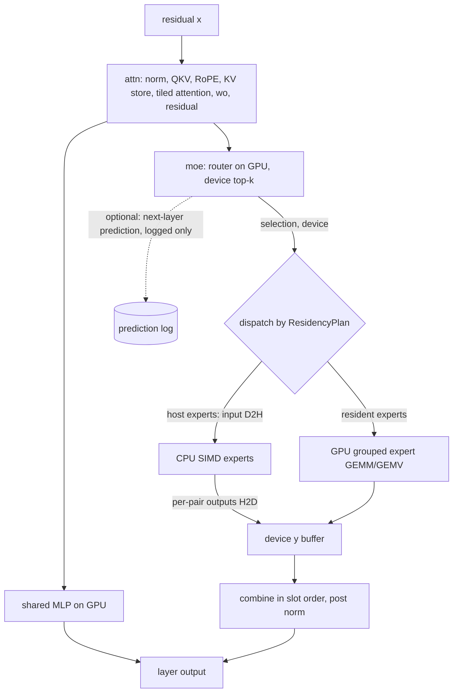

# Optimization framework

Date: 2026-11-13. Status: direction approved by the maintainer on 2026-11-13
(conditional on review of ADR 0002, which stays Proposed); revised after the
[follow-up scrutiny](optimization-research.md#follow-up-scrutiny-2026-11-13). Evidence and verdicts are in the
[optimization research](optimization-research.md). The expert placement part is
proposed as [ADR 0002](adr/0002-expert-residency-and-scheduling.md). This
document adds no new subsystem to the R2 code; it names the boundaries that
later work should use.

## Design stance

- **Few boundaries, each tied to a real decision.**
  - The ten candidate areas in the brief collapse to **five owned modules** and
    **one plan**.
  - Areas without a consumer yet (async transfer, adaptive policy) get a seam,
    not a subsystem.
- **Plan first, execute second.**
  - Every optimization that changes placement, format or batching is decided once,
    at session start, by a deterministic planner.
  - The result is an immutable `SessionPlan`. Executors read the plan; they
    do not make policy decisions.
- **One semantics, many schedules.**
  - The R2 graph (see [R2](runtime-r2-execution.md)) defines the mathematics.
  - Optimizations may change where and when work runs, and in a declared case
    the numerics within a stated tolerance.
  - They never change which experts contribute, the routing weights or the
    combine order.
- **Every optimization is a plan field with a baseline value.**
  - The baseline value reproduces R2 behaviour.
  - That makes each optimization independently switchable, recorded in the run
    manifest and comparable in a paired A/B run.

## Modules and ownership

| Module | Owns | Today in R2 | New responsibility |
| --- | --- | --- | --- |
| `plan` (new, small) | `SessionPlan`, the memory ledger, plan validation | Spread over `HipConfig` and `device_bytes_needed` | Build a plan from budget, context and objective; check it against measured free VRAM; no policy at run time |
| `residency` | Device and host homes of every weight and expert; slot table; pinned staging (later) | `DevLayer.experts: Option<..>` per layer | Residency per (layer, expert); slot ids; lifetime rules (ADR 0002) |
| `moe` | Routing, dispatch, the expert paths (GPU grouped, CPU SIMD), combine | `select_experts`, `MoePlan`, `experts_cpu`, the device loop | Device-side routing; per-expert dispatch by residency; hybrid split; prediction hook |
| `attn` | KV stores (ring and linear), KV format, attention kernels, snapshots | `k_cache`/`v_cache`, `kv_store`, naive attention | Tiled attention; global V-only option; snapshot and restore |
| `exec` | Layer sequencing, phases, cancellation, observer, instrumentation | `Session`, `HipSession` | Phase descriptor; spans and counters; streams (later) |

Kernels stay behind the C ABI (ADR 0001). Each module owns its kernels' Rust
wrappers. `hip.rs` stays the only FFI file.

## The plan

```text
SessionPlan {
  budget:     MemoryLedger        // bytes by class, checked before any allocation
  residency:  ResidencyPlan       // (layer, expert) -> Device(slot) | Host; non-expert weights: Device
  kv:         KvPlan              // per layer: Ring{cap} | Linear{cap}; format Q8_0 | GlobalVOnlyQ8 | ...
  phases:     PhasePlan           // prefill micro-batch, decode, verify(k): batch limits and MoE policy per phase
  features:   FeatureSet          // explicit toggles, each with a baseline value
  numerics:   NumericsProfile     // e.g. CPU expert activations f32 (R2) | q8_0 (reference-like)
}
```

**`MemoryLedger`.**
- **Classes:** non-expert weights, resident experts, KV, scratch (per phase,
  maximum over phases), staging, runtime overhead (measured, not guessed) and
  reserve.
- **Checks.** The planner fills the ledger. The allocator reports each actual
  allocation against its class, and a test asserts that `allocated ≤ planned`
  for every class.
- **Origin.** This generalizes R2's `held bytes == precomputed need` test.

**`ResidencyPlan`.**
- **Constructors:**
  - `first_n(n)`: exactly R2;
  - `all_device()`;
  - `explicit(list)` covers per-expert experiments. A popularity constructor is
    **not** planned: S3 found it fragile across domains;
- **Lifetime.** Immutable for the session.
- **Dynamic slots.** A dynamic slot cache, if ever approved, is a separate
  `SlotCache` owned by `residency` with its own reserved budget. The plan stays
  static.

**`PhasePlan`.**
- **Why.** The MoE policy differs by phase: computing misses on the CPU is right
  for decode (F7), while streaming experts to the GPU is right for large prefill
  batches.
- **Today.** Both use `ExecPhase { Prefill{ubatch}, Decode, Verify{k} }` with
  one policy, as in R2.
- **Policy choice.** `exec` passes the phase to `moe`, and `moe` looks up the
  policy in the plan.

**`FeatureSet` and `NumericsProfile`.**
- **Defaults.** Every flag defaults to R2 behaviour.
- **Manifest.** The run manifest records the whole plan.
- **Correctness class.** A flag that changes numerics must name its correctness
  class: bitwise, tolerance or KL band (see the
  [validation plan](optimization-validation.md#correctness-classes)).

## Data flow for one layer



- **Independent branches.** S, G and C depend only on the attention output.
  That independence is the only intra-layer parallelism.
- **Combine.** It always reads every selected pair's output from the device
  `y` buffer in slot order. The result is bitwise independent of where each
  expert ran (consistent with R2's N = 10 versus N = 20 evidence), provided each
  path's per-pair numerics are fixed.

## Execution dependencies and synchronization

**Points that must synchronize.**
- **Host-expert layers.** The selection and expert input must reach the host
  before CPU experts start. That is one D2H per such layer: selection plus
  inputs, coalesced into one copy.
- **Merging back.** CPU outputs must reach the device before the combine. That
  is one H2D per such layer.
- **End of step.** Logits or the sampled token, once per step. With on-device
  sampling this becomes 4 bytes.

**Removed relative to R2.**
- The router-logit readback on GPU-resident layers.
- The four small uploads per GPU-expert layer, because routing metadata is built
  on the device.

**Forbidden.**
- Concurrent execution of dependent layers.
- Starting layer `l+1` attention before layer `l`'s combine completes.

**Streams.**
- **R2.** The null stream only.
- **Next.** A second stream appears only with its first consumer: the hybrid
  split (A4) or prefill streaming (A7).
- **Ordering.** Every cross-stream dependency is an explicit event. There are no
  device-wide synchronizations except at cancellation and at session end.

## Memory ownership and lifetime rules

| Resource | Owner | Lifetime | Rule |
| --- | --- | --- | --- |
| Mapped GGUF | caller | Outlives sessions (R2) | Read-only; never pinned as a whole |
| Device weights and resident experts | `residency` | Session | Allocated before evaluation; immutable |
| Expert slot (only if a dynamic cache is approved) | `residency::SlotCache` | Until evicted | Reusable only after the event of every kernel reading it has completed; generation counter checked at dispatch |
| Pinned staging | `residency` | Session; bounded count | Double buffer; reusable after its copy-done event |
| KV stores | `attn` | Session | Ring and rewind invariants from R2; snapshots are copies, never aliases |
| Scratch | each module, sized by `PhasePlan` | Session | Maximum over phases; no allocation during evaluation |
| Prefix snapshots | `attn::SnapshotStore` (host RAM, later) | Bounded LRU by bytes | Keyed and scoped as in research H2; re-validated on restore |

**Failure and cancellation.**
- Cancellation is checked between layers (R2) and drains every stream before
  returning.
- A failed copy or kernel leaves `n_past` unchanged: R2's atomic evaluation
  still holds.
- After a failure, a slot cache is invalidated entirely rather than repaired.

## Feature interactions

| A × B | Interaction | Rule |
| --- | --- | --- |
| Residency × speculation | A verification batch reads about 2.7× the CPU expert bytes of one token (research G1) | The planner may prefer more GPU residency when MTP is on; measure, do not assume |
| Prefill streaming × dynamic cache | Prefill would pollute decode slots | Prefill never admits to decode slots (as in #28248's bypass) |
| Global V-only KV × prefix snapshots | Snapshot format changes | KV format is part of the snapshot key |
| Device routing × observer | Observers need host copies | Host copy only when an observer is attached; observed and unobserved runs must match bitwise |
| Graph replay × residency | Graphs bake pointers | Residency is immutable per session; a dynamic cache needs device-indexed slot tables |
| CPU numerics profile × reference comparisons | Q8_0 activations change results | The profile is part of run identity; the KL band applies |
| Tiled attention × ring buffer | Wrapping keys | Reuse R2's window-boundary fixtures unchanged |

## Interfaces to establish early

Ranked by the cost of retrofitting them later:

1. **`ResidencyPlan` replacing `cpu_expert_layers: usize`.**
   - Every MoE path, test and benchmark manifest keys off it.
   - Today it is a small change, and `first_n` keeps R2 bitwise identical.
2. **Per-pair output combine as the single merge point.**
   - Already true in R2. Write it down as an invariant now so that no later path
     sums partial results in a different order.
3. **Device-side routing output format.**
   - Selection ids, weights and the per-expert grouping (the `MoePlan`
     equivalent) live in device buffers.
   - Host code reads them only on demand.
   - Graph replay, the hybrid split and prediction logging all depend on this.
4. **`ExecPhase` passed through `eval`.**
   - Verification for MTP and n-gram drafting needs it anyway (S2).
5. **`MemoryLedger` with measured runtime overhead.**
   - Prevents every later feature from inventing its own budget arithmetic.
6. **Instrumentation spans and counters.**
   - **Spans:** host-timed per layer and per module, plus device events behind a
     flag.
   - **Counters:** blocking copies, bytes in each direction, launches, CPU
     expert time.
   - K1 needs them, and every later claim depends on them.
7. **KV snapshot and restore on the store type.**
   - Cheap while the store is simple.
8. **An internal queue handle, not a C ABI change** (maintainer decision D4).
   - Executors issue all device work through an executor-owned `Queue` value in
     `hip.rs`, which wraps the null stream today.
   - When asynchronous transfer gets a consumer, stream-taking C entry points are
     *added* beside the existing ones. Old signatures stay valid, so no caller
     breaks and the ABI change is additive.
   - No immediate need exists: R3a is host-side and synchronous.

Two of these are explicit architectural priorities (see the
[roadmap](optimization-roadmap.md#architectural-priorities)):
- **phase-aware execution** (item 4);
- **tiled attention with architecture-aware KV management** (item 7, plus the
  `attn` module's ring and linear stores and the KV format in the plan).

Deliberately **not** established yet:
- a transfer-queue framework;
- a cache policy trait;
- an auto-tuner;
- a generic multi-model abstraction.

Each needs evidence first, per the research verdicts.
