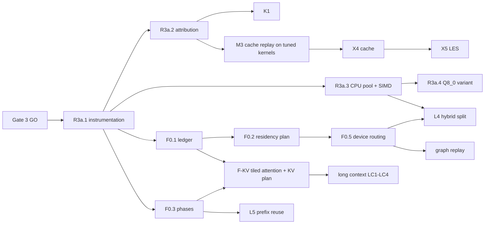

# Optimization roadmap

Date: 2026-11-13.

**Status.** The maintainer approved the direction and R3a on 2026-11-13, with
decisions D1–D7 below. Only the R3a Beads are installed. Later phases are
recorded here and in notes on existing Beads, so the backlog stays small until the
foundation is validated.

This roadmap extends the [research roadmap](research-roadmap.md). Its supporting
documents:
- [optimization research](optimization-research.md): findings F1–F10, follow-up
  S1–S4 and verdicts;
- [framework](optimization-framework.md);
- [ADR 0002 (Proposed)](adr/0002-expert-residency-and-scheduling.md);
- [validation plan](optimization-validation.md);
- [Gate 3 review](gate-3-review.md).

## Maintainer decisions (2026-11-13)

| # | Decision | Effect |
| --- | --- | --- |
| D1 | Conditional approval of static residency with CPU execution of host experts in decode; ADR 0002 stays Proposed until review | No dynamic cache or LES prefetch; keep a clean path (ADR 0002 rule 7). S3 then made first-N the default policy |
| D2 | Complete Gate 3 now | Done: **GO, scoped** ([review](gate-3-review.md)) |
| D3 | F32 activations stay the reference; Q8_0 is an experimental, configurable variant | R3a.3 is f32; R3a.4 is the flagged Q8_0 variant |
| D4 | Defer the public C ABI stream change | Internal executor-owned queue handle; stream-taking ABI entry points will be *added* when first needed (ADR 0002 rule 8). No immediate need was found |
| D5 | Create Phase 0/R3a Beads only | Four Beads installed (below) |
| D6 | Bounded, serialized experiments under router-coexistence rules | Used for S1–S4: run lock, 100 ms sensors, no stops, router idle |
| D7 | Flat documentation layout | Kept |

## Principles

- Measured improvements and clean foundations come before technique count.
- No benchmark claims against the Vulkan baseline before `tuned-k`. R3a results
  are internal ablations against `r2-ref` (about 13.4–14.0 tokens/s at N = 10,
  corrected in S1).
- Every item declares a correctness class and a measurable completion criterion.
  Performance targets are objectives, not guarantees.
- Dynamic machinery (caches, prefetch, auto-tuning) stays deferred until a trace
  replay on tuned kernels says it can win.

## Architectural priorities

Two foundations are explicit priorities, so that later work is not forced
through one generic path.

1. **Long-context memory foundation.** Tiled exact attention with separate local
   and global kernels, plus architecture-aware KV management.
   - KV management covers:
     - a ring for sliding layers and a linear store for global layers;
     - global V-only KV (F9) as a measured candidate;
     - KV format in the plan and ledger;
     - snapshot and restore.
   - R2's score scratch grows with `max_batch × max_ctx` (F8), so this
     foundation, not kernel tuning, decides whether long contexts are feasible.
2. **Phase-aware execution.** Prefill, decode and speculative verification are
   distinct `ExecPhase`s, each with its own micro-batch limits, MoE policy
   (CPU-compute host experts in decode, possibly stream them in prefill) and
   kernels (GEMV versus grouped GEMM). Verification shares the decode state
   machine but has its own batch shape (S2/G1).

## Phase 0: evidence (complete except where noted)

| ID | Item | Status |
| --- | --- | --- |
| P0.1 | Gate 3 formal decision | **Done**: GO, scoped (rv-e04-398.3 closed) |
| P0.2 | Held-out routing traces and offline predictor and placement replay | **Done for target-only** (S2, S3): 4,870 tokens over four sources. Held-out MTP-verification traces stay with M1 |
| P0.3 | PCIe and DRAM bandwidth | **Done** (S3, S4); recorded on M2 |
| P0.4 | 4.09 versus 12.7 discrepancy | **Done** (S1): contention; corrected baseline 13.4–14.0 tokens/s |

## Phase R3a: measured decode and fast host experts (installed Beads)

| Bead | Item | Class | Depends on | Done when (summary; full criteria in the Bead) |
| --- | --- | --- | --- | --- |
| rv-e05-7n3.5 | **R3a.1** Instrument the HIP decode path: spans, counters, device events behind a flag | S | — (ready) | Flag off: bitwise identical, no paired regression. Flag on: at least 90% closure; counters match the source hand count |
| rv-e05-7n3.6 | **R3a.2** Attribute the target-only decode critical path, including the per-host-layer residual of at least 0.6 ms | — | R3a.1 | Residual attributed or bounded; ranked hypotheses with failure thresholds. Now blocks K1 (rv-e05-7n3.1) |
| rv-e06-k0i.5 | **R3a.3** Persistent CPU worker pool and SIMD f32 Q4_0 expert kernel | T | R3a.1 | Within 1e-5 of the scalar path; KL band holds; objective ≤ 1.5 ms per layer in situ (prototype: 0.54 ms) |
| rv-e06-k0i.6 | **R3a.4** (experimental) Q8_0-activation variant behind a numerics flag | N | R3a.3 | Band holds and it is faster beyond noise, or it is documented and disabled |

**Minimal next executable task: R3a.1 (rv-e05-7n3.5).** It changes no
semantics and needs no refactor. Every later number depends on it.

## Later phases (recorded, not installed)

These become Beads only after R3a validates the foundation and the measurements.

**Foundations.** Class S unless noted.

| ID | Item | Depends on | Done when |
| --- | --- | --- | --- |
| F0.1 | `MemoryLedger` with measured runtime overhead (about 0.64 GiB observed) | R3a.1 | Planned ≥ allocated for every class |
| F0.2 | `ResidencyPlan` (`first_n` default) and slot table with generation counter | F0.1; ADR 0002 accepted | `first_n(10)` bitwise equal to R2; synthetic plan permutations bitwise equal |
| F0.3 | `ExecPhase` through `eval` (priority 2) | R3a.1 | No behaviour change; phase in manifests |
| F0.5 | Device-side routing | F0.2 | Selection identical; blocking copies per token reduced |
| F-KV | Tiled attention, local and global (K3), and a KV plan with ring and linear stores and format (priority 1) | F0.1, F0.3 | Scratch independent of `max_ctx`; window fixtures pass (class T) |

**Low risk.**

| ID | Item | Depends on |
| --- | --- | --- |
| L2 | On-device greedy argmax and last-row logits | F0.3 |
| L4 | Hybrid same-layer split and resident-first ordering | F0.5, R3a.3 |
| L5 | In-session prefix reuse | F0.3 |

**Kernels** (existing K2/K3; Gate 4): tuned Q4_0 GEMV; grouped MoE GEMM with
WMMA for prefill; fusion and graph replay after F0.5.

**Long context** (Q2/Q1):
- LC1: global V-only KV (class N);
- LC2: 16K–256K feasibility sweep;
- LC3: cross-request snapshots with an isolation review;
- LC4: Q4 KV for global layers.

**Experimental** (each needs its own GO):
- X1: async copies and prefill expert streaming;
- X2: MTP (S2/S3);
- X3: n-gram drafting;
- X4: dynamic slot cache (M3/M4);
- X5: LES prefetch (M3/M4; S2 bounds it at about 1 ms per token today).

**Deferred pending evidence:**
- popularity placement as a default (S3);
- online auto-tuning;
- re-planning between requests;
- paged KV;
- KV spill to RAM;
- independent draft models;
- layer-skip self-speculation.

## Dependency order

## Unresolved architectural blockers

1. **The per-host-layer residual (at least 0.6 ms, S3).** After R3a.3 it may
   dominate host-expert cost. It decides any non-contiguous placement, and the
   value of the hybrid split. R3a.2 owns it.
2. **ADR 0002 acceptance.** It blocks F0.2 and everything that depends on
   residency, but not R3a.
3. **Pool policy under a shared host.** Spinning workers versus parked workers,
   their interaction with HIP runtime threads, and contention sensitivity (S1).
   R3a.3 must choose and measure.
4. **Long-context feasibility.** It needs F-KV before Q2 can run beyond about
   32K at prefill batch 512.
