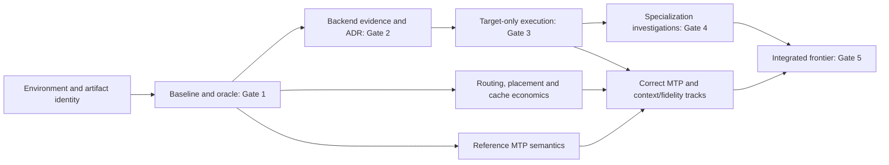

# Research roadmap and local Beads index

Proposed program, 2026-11-11. Created with Beads Rust 0.7.6 in this Rosevine
repository: **9 epics, 32 substantive tasks including 6 decision gates, 41 total
issues**. All are future work; no experiment or gate is complete. Full objectives,
rationale, preconditions, scope, artifacts, measurable criteria, verification and
risks are in each local Bead. This manually authored plan references issue IDs;
it is not a database export. All raw Beads state remains private and ignored.

## Current execution status

Epic 1 characterization is complete with a reviewed **NO-GO** outcome for
baseline performance experiments; see the [Gate 0 record](gate-0-review.md),
[environment report](environment-characterization.md) and
[artifact/reference evidence](epic-1-evidence.md). This records an agent evidence
review, not human architecture or run approval. No positive gate has passed.
B3 remains deferred pending reference/safety follow-up and an updated gate outcome.
The initial counts, ready set and future-work statements below describe the
planning snapshot; local Beads are authoritative for current issue status.

## Storage and execution policy

The current direct handoff authorizes the research phase and repository-local
tracker adoption after Project Zero. It supersedes that phase's no-roadmap/no-init
restriction; it does not change the [Beads storage policy](development/beads-policy.md)
or [privacy policy](development/privacy-policy.md). No tracker was initialized in
another project, enrolled in memory synchronization, or synchronized to GitHub.
No policy/allowlist change or public export is included.

Use `br where --json` to verify scope, `br ready --json` and `br show ID --json`
to inspect work, then claim authorized work with a public-role actor. Parent-child
links organize epics. Explicit blocking links determine execution order:
`br dep add A B` means A waits for B. All listed dependency edges are installed.
Use `br dep cycles --json` and `br sync --flush-only --json` for handoff checks.
The private database and portable local export are not Git deliverables.

Labels include research, correctness, infrastructure, backend, performance, moe,
quantization, mtp, memory-management, multimodal, implementation, gate, decision
and approval-required. Research spikes use task type plus research label;
implementation and gate issues are explicitly labeled. No issue is assigned or
claimed merely because the plan was created.

Ten conditional implementation/packaging tasks start **deferred**: R1, R2, K2,
K3, M4, S2, S3, Q1, V2, V3. For Q1, its read-only sensitivity study may later
be activated separately; transformations remain conditional. Benchmark-harness
work B1 is future infrastructure, not inference implementation. The current
assignment authorizes planning only; do not execute future issue work in this turn.

Beads dependency closure cannot represent a scientific outcome by itself. A gate
can finish with GO, NO-GO or PIVOT. Closing it does **not** make implementation
authorized. Keep affected issues deferred after NO-GO; record the alternate
investigation and only activate a concrete branch after the required review.
When a candidate is rejected, dependent study issues may complete by producing
their specified negative/no-build conclusion, rather than fabricating an
implementation. No performance improvement is assumed as a future dependency.

## Epic map

| Program | Actual epic ID | Tasks | Outcome |
| --- | --- | --- | --- |
| RV-01 Hardware and Environment Characterization | rv-e01-898 | 3 | Environment and exact artifact identity reviewed at Gate 0 |
| RV-02 Reproducible Benchmarking and Reference Correctness | rv-e02-22u | 4 | Workloads, metrics, oracles and baselines frozen at Gate 1 |
| RV-03 Backend and Compiler Evaluation | rv-e03-mmf | 4 | HIP/Vulkan/framework evidence and reviewed ADR at Gate 2 |
| RV-04 Minimal Gemma-Specific Reference Runtime | rv-e04-398 | 3 | Correct target-only text execution at Gate 3 |
| RV-05 Specialized Kernels and Memory Layouts | rv-e05-7n3 | 4 | Validated benefit or documented negative result at Gate 4 |
| RV-06 MoE Execution and Heterogeneous Memory | rv-e06-k0i | 4 | Measured locality, static placement and conditional cache/overlap policy |
| RV-07 MTP and Speculative Execution | rv-e07-ktl | 3 | Assistant/KV correctness and actual speculative costs |
| RV-08 Quantization, Context, and Performance Frontier | rv-e08-nhh | 4 | Fidelity-aware integrated frontier reviewed at Gate 5 |
| RV-09 Multimodal Support and Research Integration | rv-e09-0s4 | 3 | Later CPU projector support and reproducible independent packaging |

## Task index and installed blockers

Keys in the last column map to actual IDs in this table. A dash means no blocking
Bead; it does not waive policy, run-window or implementation authorization.
Detailed criteria are maintained in Beads, with shared definitions in the
[protocol](experiment-protocol.md).

| Key | Actual task ID | Investigation or implementation | Depends on |
| --- | --- | --- | --- |
| H1 | rv-e01-898.1 | Environment, DIMM gaps, device selection, telemetry access and safe run envelope | — |
| H2 | rv-e01-898.2 | Independent GGUF/provenance, template tokens, sampler and matching build/tool semantics | — |
| G0 | rv-e01-898.3 | Gate 0 environment/reference review | H1, H2 |
| B1 | rv-e02-22u.1 | Fixed workload/metric/result infrastructure and resource cancellation | — |
| B2 | rv-e02-22u.2 | Intermediate/logit oracle, quality corpus and numerical tolerance calibration | H2 |
| B3 | rv-e02-22u.3 | Reproduce presets; controlled capacity × placement × MTP comparisons | G0, B1, B2 |
| G1 | rv-e02-22u.4 | Gate 1 baseline and protocol freeze | B3 |
| C1 | rv-e03-mmf.1 | HIP/rocBLAS compiler, exact-shape correctness and matched full-model phases | G1 |
| C2 | rv-e03-mmf.2 | Vulkan feature/shader/pipeline/ISA and exact-shape/full-model evaluation | G1 |
| C3 | rv-e03-mmf.3 | Triton feasibility; identical-kernel C++/Rust FFI and automation costs | G1 |
| G2 | rv-e03-mmf.4 | Gate 2 backend/runtime ADR and human decision | C1, C2, C3 |
| R1 | rv-e04-398.1 | Deferred: validated GGUF/mmap/tokenizer and text/modality input boundary | G2, H2, B2 |
| R2 | rv-e04-398.2 | Deferred: exact target-only graph, static placement, Q8_0 KV and cleanup | R1 |
| G3 | rv-e04-398.3 | Gate 3 target-only reference correctness | R2, B2 |
| K1 | rv-e05-7n3.1 | Critical-path attribution, counters/timestamps and ranked hypotheses | G3, S1 |
| K2 | rv-e05-7n3.2 | Deferred: Q4_0 GEMV/GEMM, unpack/packing and integrated benefit test | K1 |
| K3 | rv-e05-7n3.3 | Deferred: local/global attention, norm/GELU fusion, graphs and scratch/scheduling | K1 |
| G4 | rv-e05-7n3.4 | Gate 4 specialization benefit or negative-result review | K2, K3 |
| M1 | rv-e06-k0i.1 | Existing cache audit and real held-out routing traces | G1 |
| M2 | rv-e06-k0i.2 | Static/noncontiguous placement, CPU SIMD and transfer economics | G1 |
| M3 | rv-e06-k0i.3 | Cache-policy bounds, trace replay, overlap and held-out go/no-go | M1, M2 |
| M4 | rv-e06-k0i.4 | Deferred: reviewed evidence-supported memory policy, or documented no-build outcome | G3, M3 |
| S1 | rv-e07-ktl.1 | Assistant/KV/sampling state machine, natural acceptance and verification costs | G1 |
| S2 | rv-e07-ktl.2 | Deferred: correct MTP3, rejection/correction, shared KV and rollback | G3, S1 |
| S3 | rv-e07-ktl.3 | Deferred: MTP schedule/cache interactions and end-to-end measurements | S2, M3 |
| Q1 | rv-e08-nhh.1 | Deferred: tensor/expert sensitivity and reversible/lossy derivative fidelity | G3, B2, M3 |
| Q2 | rv-e08-nhh.2 | Actual occupied 64k/128k/256k feasibility, KV allocation and correctness | G1, G3, S1 |
| Q3 | rv-e08-nhh.3 | Integrated comparable Pareto points, sustained performance and energy limits | G4, M4, S3, Q1, Q2 |
| G5 | rv-e08-nhh.4 | Gate 5 end-to-end frontier and continuation decision | Q3 |
| V1 | rv-e09-0s4.1 | Later CPU projector, image token/position/mask contract | H2, G2 |
| V2 | rv-e09-0s4.2 | Deferred: image-conditioned implementation and text/multimodal correctness | G3, V1 |
| V3 | rv-e09-0s4.3 | Deferred: reproducible package and optional integration proposal | G5 |

## Decision gates

No gate has passed. A gate report records outcome, evidence/versions, limitations,
review and the next discriminating action. Accepted ADRs require explicit human
review; a plan document cannot accept its own proposed architecture.

| Gate | GO condition | NO-GO / PIVOT path |
| --- | --- | --- |
| 0 | Device/tool inventory and exact reference identity established; unknowns bounded; safe short-test envelope | Resolve identity/template/build mismatch or access gap; no unsupported backend certification |
| 1 | Same manifest reproducible with documented variance, usable independent oracles and frozen comparison rules | Investigate measurement contamination, tokenization, provenance or reference instrumentation |
| 2 | Correct viable backend coverage, paired shape/full-model evidence, and human-accepted runtime ADR | Continue compiler/compatibility research or retain pinned llama.cpp as experimental platform; no runtime activation |
| 3 | Target-only short text, per-layer/logit/routing and state/resource checks pass predeclared thresholds | Debug the first divergent operation/state; no MTP or optimized execution |
| 4 | At least one path passes fidelity and useful-benefit criteria, paired intervals and second-session reproduction | Preserve correct unoptimized fallback; reject unhelpful kernels; final comparison can still proceed |
| 5 | Complete supported frontier and honest mission-objective/feature accounting support scoped continuation | Report no advantage or missing essential capability; stop or propose a specific new hypothesis |

Gate 4's proposed useful-benefit rule is >=5% in a named primary metric with a
paired 95% improvement interval above zero, no unacceptable quality change and
all regressions reported. Gate 1 freezes or revises that proposal before testing.
Gate 5 is a research decision, not an obligation to show a custom engine wins.
Unsupported MTP or context remains an unmet target even when another metric wins.

## Critical path and parallel research

The principal text-runtime path is:

`H1 + H2 → G0; H2 → B2; G0 + B1 + B2 → B3 → G1 → C1/C2/C3 → G2 → R1 → R2 → G3`.

From Gate 1, independently investigate `M1 + M2 → M3` and `S1`. Their results
inform runtime scheduling and prevent designing a cache that duplicates existing
functionality. After Gate 3, `K1 → K2/K3 → G4`, `M4`, `S2 → S3`, `Q1` and `Q2`
feed `Q3 → G5`. Final study waits for the outcomes of candidate investigations,
not presumed positive improvements. Actual installed blockers are the task table.

The image track V1/V2 is subsequent to correct text execution and does not block
the text performance frontier. V1's contract review can inform R1/R2 boundaries
once the backend ADR exists. Packaging follows the final research decision;
production integration remains a separately authorized proposal.

## Recommended first work

1. **H2 — rv-e01-898.2:** resolve actual quantization, canonical/template token
   parity and reference build/tool identity. These are the highest-impact
   uncertainties discovered in planning.
2. **H1 — rv-e01-898.1:** complete environment gaps and a reviewed measurement
   envelope; DMI established DIMM capacity/channels/rate, while current timings
   and effective bandwidth remain unresolved.
3. **B1 — rv-e02-22u.1:** create fixed prompt/metric/manifests and failure-preserving
   infrastructure; its design can proceed without GPU work.
4. **B2 — rv-e02-22u.2:** after H2, freeze independent numerical/quality oracles.
5. **G0 — rv-e01-898.3:** after H1/H2, review readiness for bounded baseline runs.

The initial ready set is H1, H2 and B1. B3 follows Gate 0 plus the benchmark and
oracle infrastructure; backend and cache experiments follow Gate 1. No inference
runtime/kernel work begins as part of this planning handoff.

## Approval boundaries and handoff

Before implementation: review the concrete backend/language ADR at Gate 2 and
authorize the runtime work. Any representation or dynamic memory-policy decision
requires its applicable reviewed evidence/ADR. Numerical thresholds and display
headroom must be frozen before performance comparisons, not tuned afterward.

Separately approve system dependencies, large downloads,
long GPU run windows, changes to drivers/services, publication/schema changes,
commits/pushes/merges or production integration. No such action is included here.
Beads future closures must meet CONTRIBUTING's Definition of Done, retain negative
results and include Root cause / Resolution / Verification / Engineering takeaway
for significant work. Planning inspection is not completion evidence for the
future experimental Beads.
